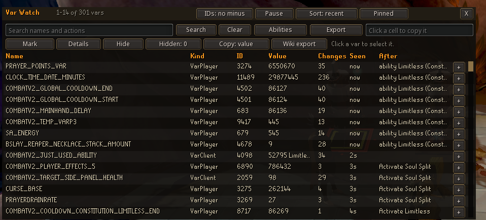
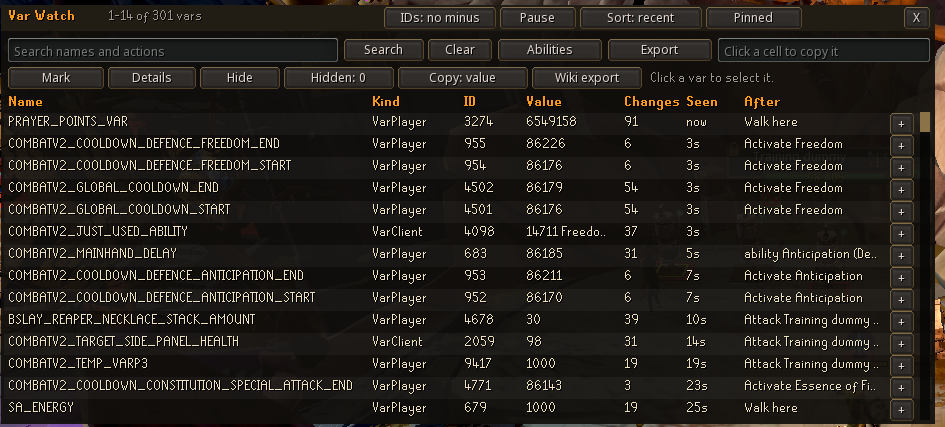

# Var Watch

A RuneScape 3 plugin that shows every game variable the server changes while you play. Useful when you're making a
plugin and need to find which var tracks what.



Everything it sees goes into a list that's kept between sessions, so it knows more the longer you leave it on. Each
change also shows what you'd just done (clicked something, used an ability or gained XP), so you can tell which action
changed which var.

No permissions needed and nothing gets sent anywhere. The list is saved on your PC.

## What it can do

- Search by var name or by the action that changed it
- Sort by most recent, most changes or name
- Pin vars to keep them at the top
- Mark: from now on, only show what changes, with the old and new value
- Details: the last 20 values of a var, and for a varbit, which var it belongs to and which bits
- Hide vars that change all the time, like clocks
- Click any cell to copy it, or copy a whole row as a wiki table line
- Abilities: learns which ability ID is which ability as you use them
- Export the list or the abilities as a spreadsheet, or the list as a wiki table
- Print every change in the dev console too
- Drag the window by its title bar



## Install

1. Copy the `var-watch` folder into your plugins folder. For the beta client that's
   `C:\ProgramData\Jagex\RuneScape-BETA\dev_plugins\`
2. Open the console with Alt + `` ` ``, type `prf`, then `prl var-watch`

Settings are under the cog next to it in the Plugin Hub: show the window, print changes in the console, and
Negative IDs (on shows varbit IDs with the minus sign, the way the game sends them).

## Using a var you found

In your own plugin: `var.VarPlayer.NAME.value` or `var.VarClient.NAME.value`, or listen to `Event.VarTransmit`.

## Getting an export out of the game

Plugins can't write files, so Export saves into the plugin's own storage. Click Export in game, then run:

```
python tools/var_watch_export.py
```

That gives you `var-watch-export.tsv` (or `var-watch-export-wiki.txt` for a wiki export) in the folder you ran it
from. It reads a copy of the plugin database and never changes the real one. Use `--db` for a different client's
PluginData.db and `--out` to pick the file name.

## Tests

They run outside the game, against a mock of the plugin API:

```
lua tests/test_var_watch.lua
lua tests/test_var_watch_export.lua
python tests/test_var_watch_export_tool.py
```

## License

MIT
